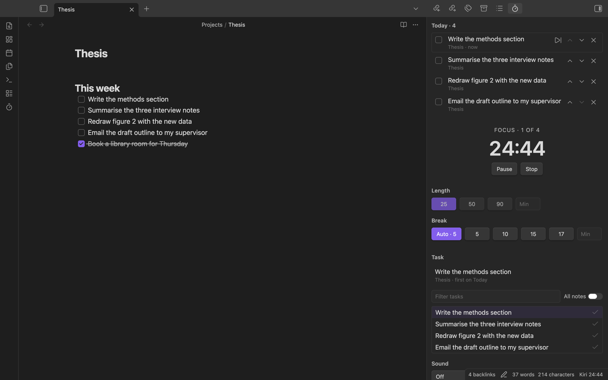
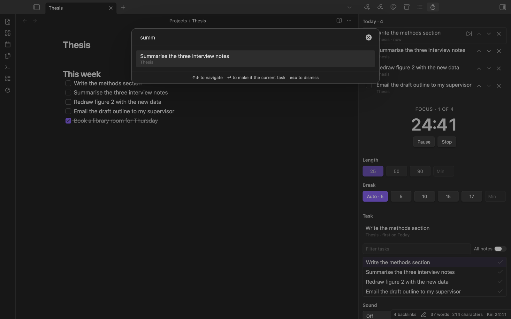
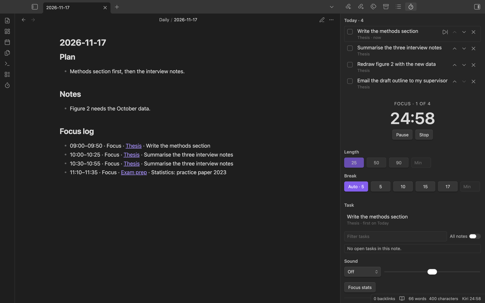

# Kiri Focus Timer

A focus timer that lives in your Obsidian sidebar. Pick a task from your notes, start a block, and get a line in your daily note when it ends.

Made by the maker of [Kiri](https://project-kiri.com), a focus timer for your laptop. This plugin is free and works fully offline. A Kiri account is optional (see "Kiri account" below).

## What it does

- **Timer in the sidebar.** Open the Kiri panel from the ribbon or the command "Open Kiri". Choose 25, 50 or 90 minutes, or type your own length from 5 to 120. Start, pause and stop.
- **Countdown in the status bar.** While a block runs, the status bar shows the time left, for example `Kiri 18:42`. Click it to open the panel. (The status bar is not shown on phones and tablets.)
- **Breaks.** After a focus block, a break starts: 5 minutes after 25, 10 after 50, 15 after 90. You can change these or turn breaks off. To set the break yourself, use the Break row under the length buttons in the panel: Auto (shows what it gives now, for example "Auto · 5"), 5, 10, 15 or 17 minutes, or type 1 to 60. Your choice is used after every block, whatever its length; a break already running keeps its length, and a break waiting for "Start break" takes the new one. The next block starts when you press start, or by itself if you turn that on. Even then Kiri waits for you after a long break, after 4 blocks in a row that started by themselves, and after a break that ended while your device slept, so a cycle never runs on for hours with nobody there.
- **Long breaks.** Every 4th block is followed by a 15 minute break. You can change both numbers or turn long breaks off. The panel shows where you are, for example "Focus · 2 of 4". A gap of two hours starts the count again.
- **Start breaks yourself (optional).** Turn off "Start the break by itself" and Kiri waits for you to click "Start break".
- **Chime.** A chime plays when a block or break ends: a two-note bell, or a soft single low note. Both are made on your device. You can turn it off.
- **Sound.** Brown, pink or white noise, made on your device while you focus. It fades in when a block starts and fades out when a break starts. There is a volume slider.
- **Tasks from your notes.** The panel lists open tasks (`- [ ] Draft intro`) from the note you have open. Turn on "All notes" to search the whole vault. Tasks written for the Tasks plugin, like `- [ ] Draft intro 📅 2026-11-20`, work as they are. Cards on a Kanban board (a note with `kanban-plugin` in its frontmatter) are not tasks for Kiri: they are never listed and Kiri never edits a board.
- **Today list.** At the top of the panel, put together the tasks you want to do today, from any notes, and tick them off as you go. Click **+** next to a task in the list below to add it (a task already on Today shows a check mark), right-click a task in a note and choose "Add to Today", or run "Add open tasks from this note to Today". Drag tasks to reorder them, or use the up and down buttons (they work from the keyboard). The **x** takes a task off the list without changing the note. Today holds up to 30 tasks.
  - **The first task is the one you focus on.** The timer, the log line and the time spent use it. When Today is empty, you pick a single task from the list as before. If you had picked one, it becomes the first task on Today when you add the first one. Clicking a task in the list (or "Focus on this task") while Today has tasks moves it to the top of Today.
  - **Switch task.** Click a task's words on Today (or focus them and press Enter or Space) to make it the current task. The **Next task** button on the current task sends it to the end of Today, still open, and the next one becomes current. The commands "Switch task…" (a search over Today's tasks; while Today is empty, over the open tasks of the note you have open) and "Next task" do the same from the keyboard. Set hotkeys for them in Settings → Hotkeys.
  - **Switched during a block.** The block goes on and its time is split. Whenever the current task changes during a block (a click, "Switch task…", "Next task", moving or dragging the first task down, "Focus on this task", or removing the current task with **x**), the task you leave gets the time since the last switch: with "Add time spent to the task" on, those minutes are added to its `[spent::]` field. It is not marked done. A switch back within half a minute writes nothing. If Kiri cannot find the line of the task you leave, it says so once and the block goes on. The log line still names the task that is current when the block ends.
  - **Tick it off.** Ticking a task marks it done in its note (through the Tasks plugin when it is on, so done dates and recurring tasks work; otherwise `[ ]` becomes `[x]`) and the next task becomes the first. If the task line cannot be found any more, Kiri says so and keeps the task on the list. Tasks ticked in the note itself leave Today too, and a task whose dates or fields you edit is followed. Only the task's own line counts: an older, already completed copy of the same task elsewhere in the note is never taken for it. A task Kiri cannot find in its note any more (its words were changed, or its note was deleted) stays on the list marked "not found in the note"; remove it with **x**, or it recovers when the line or note comes back. Renaming or moving a note keeps its tasks on Today.
  - **Ticked during a block.** The block goes on. With "Add time spent to the task" on, the time so far is added to the finished task's `[spent::]` field in the same edit, and the rest of the block goes to the task that is first when the block ends. The log line, the block counter and the block sent to a Kiri account name the task that is first when the block ends (or, if Today is empty by then, the first task finished during the block). If you stop the block early, the time already added to tasks you ticked stays on them: it is time you did spend on them. A stopped block writes no log line, so in that case "Time per note" in the stats can show less than the `[spent::]` fields.
  - **Recurring tasks.** When the Tasks plugin completes a recurring task, the time goes on the completed occurrence. The new occurrence starts without Kiri's `[spent::]` and `[kiri::]` fields (your `[planned:: ...]` is kept).
  - **A new list each day.** Today is saved with the plugin's settings and starts empty at midnight. Turn on "Keep the Today list across days" to keep it. A block running at midnight keeps its task: the list is cleared when the block ends. A clock set back (or a flight west) never clears it. If the plugin's data file changes from outside, for example synced from another device, the panel takes the list from it.
- **Focus on this task.** Right-click an open task in a note and choose "Focus on this task", or run the command with the cursor on the task line. Kiri picks the task and starts a block. If a block is already running, it switches that block to the task.
- **Focus log.** When a block ends, Kiri adds a line to today's daily note, under a "Focus log" heading:

  ```md
  ## Focus log
  - 10:00–10:25 · Focus · [[Website relaunch]] · Draft intro
  ```

  Kiri uses the folder and date format of the core Daily notes plugin. **By default Kiri does not create today's daily note.** If it does not exist yet when a block ends, the line goes to a note called `Kiri focus log.md` in the vault root, and Kiri says so (once a day). This way Kiri never makes a second "today" note before a sync service brings the one you wrote on another device. Turn on "Create the daily note if it is missing" to have Kiri create it from your Daily notes template; if that template cannot be found, Kiri creates no note (never an empty one), logs to `Kiri focus log.md` and names the missing template. A block that Kiri notices more than a minute after it ended (the lid was closed, the phone slept) waits 20 seconds before it writes, so a sync service can bring today's note first. If Daily notes is off, the lines always go to `Kiri focus log.md`. Lines in that note start with the date (for example `- 2026-11-15 10:00–10:25 · Focus`), so stats can count them. The line holds the task's words only: its tags, inline fields (`[project:: Alpha]`), block id and links are left out (a link keeps its text), so the daily note gets no extra tags, fields or backlinks. The link to the task's note stays; stats use it. If you paused the block, the line shows the focus minutes after the label, for example `- 10:00–11:05 · Focus (25m)`, and stats count those 25 minutes. A block that ended while the computer slept is logged with the time it was due to end.
- **Focus stats.** Click "Focus stats" in the panel, or run "Show focus stats". You see minutes and blocks for today and this week, your streak (days in a row with at least one block) and time per note for this week, the last 30 days or all time. The numbers come from the focus log lines in your daily notes, so editing or deleting a line changes them. Nothing is sent anywhere.
- **Block counter (optional).** Kiri can count blocks on the task line itself with a `[kiri:: 2]` field. Dataview can read it. The field goes before any Tasks plugin dates, so those keep working.
- **Time spent (optional).** Kiri can add each block's minutes to a `[spent:: 1h 15m]` field on the task line. A `[spent::]` field you already use is read as time (a plain number as minutes) and rewritten; a value Kiri cannot read is left alone. Add `[planned:: 2h]` (or `[estimate:: 2h]`) yourself, and the panel shows "Spent 1h 15m of 2h planned". Like the counter, the field goes before Tasks plugin emoji fields, Tasks fields in Dataview style such as `[due:: 2026-11-20]`, and block ids, so the Tasks plugin still reads the task. Each block is added once: the edit only happens if the line is still exactly as Kiri last saw it.
- **Mark done (optional).** Kiri can ask "Mark task done?" after a block. If the Tasks plugin is on, Kiri asks it to complete the task, so recurring tasks and done dates work. Otherwise `[ ]` becomes `[x]`.
- **A running block survives closing Obsidian.** The block in progress, the cycle count and the picked task are saved on this device (not synced, so a block never moves to another device). When Obsidian starts again, a block still running goes on; one that ended while Obsidian was closed is logged with the time it ended.

Kiri only changes your notes in the ways listed above (ticking a Today task is one of them). It edits one line at a time and checks that the line is still there first. If a note holds the same task line more than once, Kiri remembers which copy you picked (the second of two, say) and follows it however far it moves; if it can no longer tell the copies apart (another copy was added, or one was removed), it changes nothing and says so.

## What Kiri writes to your notes, and when

| What | Where | When | On by default |
| --- | --- | --- | --- |
| A line like `- 10:00–10:25 · Focus · [[Note]] · task words` | Today's daily note, under `## Focus log` (heading added at the end if missing) | When a focus block runs to its end. A stopped block writes nothing. | Yes ("Log each block") |
| The same line, starting with the date | `Kiri focus log.md` in the vault root (created the first time) | Instead of the above, when today's daily note does not exist yet, or Daily notes is off | Yes |
| Today's daily note, from your template | Your Daily notes folder | When a block ends and the note does not exist yet | No ("Create the daily note if it is missing") |
| `[kiri:: 3]` on the task line | The task's note | After each block | No ("Count blocks on the task") |
| `[spent:: 1h 15m]` on the task line | The task's note | After each block, when you tick a Today task during a block, and when you switch away from the current task during a block (that task gets the minutes since the last switch) | No ("Add time spent to the task") |
| `- [ ]` becomes `- [x]` (through the Tasks plugin when it is on) | The task's note | When you tick a task in the Today list, or answer "Mark done" | The Today checkbox: always. The question: no |
| Nothing | Any note | On startup, at midnight, when the panel opens, when searching all notes, when showing stats | |

Kiri never writes frontmatter, never renames, moves or deletes a note, and never edits a Kanban board. Every edit goes through Obsidian's `Vault.process` and changes one line or adds one line. If you disable or remove the plugin, everything above stays in your notes as plain text; search for `· Focus`, `[kiri::` and `[spent::` to find it.

### A safe first run in a large vault

1. Make a copy of the vault, or check that the File recovery core plugin is on.
2. Keep the defaults: "Create the daily note if it is missing", "Count blocks on the task", "Add time spent to the task", "Ask to mark the task done" and "Start the next block after the break" are all off. With these defaults Kiri only adds one line per finished block (to today's daily note if it exists, otherwise to `Kiri focus log.md`), and ticks a task only when you tick it in the Today list.
3. Open today's daily note before the first block, so the line goes there.
4. Do not connect a Kiri account yet: then nothing is downloaded and nothing is sent.
5. After the first block, look at the daily note: one line under `## Focus log`, nothing else changed. Then try "Add time spent" on one throwaway task before using it widely.

## Screenshots

The Kiri panel next to a note: Today list, timer, block and break length.



Switch task: type part of a task and press Enter to make it the current one.



Each finished block adds one line under "Focus log" in your daily note.



## Install

Needs Obsidian 1.13 or later.

**From Community plugins.** In Obsidian, open Settings → Community plugins → Browse, search for "Kiri Focus Timer", then install and enable it. Or open the [listing](https://community.obsidian.md/plugins/kiri-focus-timer) directly.

**Manual install.**

1. Download `main.js`, `manifest.json` and `styles.css` from the latest release on the Releases page of this repository.
2. In your vault, create the folder `.obsidian/plugins/kiri-focus-timer/`.
3. Put the three files in that folder.
4. Restart Obsidian, then enable "Kiri Focus Timer" in Settings → Community plugins.

## Commands

- Open Kiri
- Start focus block
- Start or pause
- Pause or resume
- Stop timer
- Skip break
- Focus on this task (needs the cursor on an open task line)
- Switch task…
- Next task
- Add open tasks from this note to Today
- Show focus stats

There are no default hotkeys. You can set your own in Settings → Hotkeys.

## Settings

| Setting | Default | What it does |
| --- | --- | --- |
| Focus length | 25 | Minutes per block, 5 to 120. The buttons in the panel change it too. Number fields are applied when you leave the field or press Enter, and show the value in use. |
| Chime | On | Chime when a block or break ends. |
| Chime sound | Bell | Bell (two notes) or soft (one low note, quieter). |
| Take a break after each block | On | Starts a break after each focus block. |
| Break length | Auto (by block length) | Or set minutes, 1 to 60, used after every block. The Break row in the panel changes it too. |
| Break lengths | 5 / 10 / 15 | With Auto only: break after blocks up to 25 minutes, up to 50 minutes, and longer. |
| Long break | On | A longer break after every few blocks. |
| Long break length | 15 | Minutes. Replaces the break every few blocks. Never shorter than the normal break. |
| Long break every | 4 | Blocks, 2 to 12. |
| Start the break by itself | On | When off, Kiri waits for you to start the break. |
| Start the next block after the break | Off | When off, Kiri waits for you. When on, Kiri still waits after a long break, after 4 blocks in a row that started by themselves, and after a break that ended while the device slept. |
| Noise (Sound when connected) | Off | Off, brown, pink or white noise. With a Kiri account, also the Kiri sounds (downloaded on first play, 15 to 25 MB each). |
| Downloaded sounds | | Only with a Kiri account. Shows how many Kiri sounds are downloaded and their size, and deletes them. |
| Volume | 50 | Sound volume. |
| Binaural beats | Off | Only shown when your Kiri account includes them. |
| Binaural volume | 30 | Capped low, whatever the slider says. |
| Log each block | On | Adds a line to today's daily note (or to `Kiri focus log.md`, see above). |
| Create the daily note if it is missing | Off | When on, Kiri creates today's daily note from your template if it does not exist when a block ends. When off, the line goes to `Kiri focus log.md` and Kiri says so. |
| Log heading | `## Focus log` | The heading the lines go under. It is added if missing. |
| Count blocks on the task | Off | Adds or updates `[kiri:: N]` on the task line. |
| Add time spent to the task | Off | Adds each block's minutes to a `[spent::]` field on the task line. |
| Ask to mark the task done | Off | Asks after each block. |
| Keep the Today list across days | Off | When off, Today starts empty each day at midnight. |
| Send finished blocks to Kiri | On | Only with a connected Kiri account. See below. |

## Kiri account (optional)

Without an account, everything above works and the plugin makes no network requests at all.

If you have a Kiri account at [project-kiri.com](https://project-kiri.com), you can connect it in Settings → Kiri Focus Timer → Kiri account:

1. Click **Connect**. A Kiri page opens in your browser, and the settings show a code such as `ABCD-EFGH`.
2. Sign in on that page if asked, check that it shows the same code, and click **Allow**.
3. The settings now show "Connected as ..." with your plan.

With an account connected:

- **Kiri sounds.** The sound list shows the sounds of your Kiri account. A sound is downloaded only when you play it for the first time, never in advance, and kept in the plugin folder (`.obsidian/plugins/kiri-focus-timer/sounds/`, inside your vault), so it is only downloaded once. Kiri's sounds are real recordings of about **15 to 25 MB each**; all of them together come to about 220 MB. Settings → Sound shows how many are downloaded and how much space they take, with a **Clear downloaded sounds** button. Because the folder is inside your vault, a sync or backup service (Obsidian Sync, iCloud, Dropbox, git) may copy these files too. If you keep your vault in git, add this line to `.gitignore`: `.obsidian/plugins/kiri-focus-timer/sounds/`. Some sounds need a paid Kiri account; they are marked "(locked)" and link to [the pricing page](https://project-kiri.com/pricing). The brown, pink and white noise made on your device stay in the list.
- **Binaural beats.** If your account includes them (all beats, or only Alpha on some free accounts, the same as on the site), you can turn on binaural beats: two steady tones, one in each ear, a few hertz apart. They are made on your device with Web Audio, are off by default, and are kept quiet. Use headphones.
- **History.** Each finished block is added to your Kiri history, so it counts in your streak and calendar on project-kiri.com. You can turn this off with "Send finished blocks to Kiri". If you are offline, blocks wait in a small queue and are sent when Obsidian starts or after your next block.
- **Kiris.** Blocks sent to Kiri earn kiris, the same as on the site (about 1 for a 25 minute block). When a block is sent, a notice shows what it earned, for example "+1 kiri" or "+0.4 kiri". Blocks that waited offline count when they are sent. The panel footer and Focus stats show your total. Without an account nothing about kiris is shown.

**Disconnect.** Click **Disconnect** in the same place. Kiri asks the server to cancel the connection, forgets it in the plugin, deletes the downloaded sounds and goes back to the local noise. You can also remove the connection on project-kiri.com.

**Where the connection is kept.** Each device you use connects on its own. The connection key is a long random token that only works for the plugin's own endpoints. It is kept in Obsidian's secret storage on your device. The account details (name, email hint, plan) and the blocks waiting to be sent are kept in Obsidian's local storage on your device, not in your vault files, so they do not travel with the vault, and a device that is not connected cannot remove another device's connection. To end it, disconnect, or remove the connection on the site.

**Blocks belong to the account they were made under.** If the connection stops working (for example because you removed it on project-kiri.com), blocks that were still waiting to be sent are deleted, so they can never go to a different account you connect later.

## Privacy and network use

- **No account, no network.** Until you connect a Kiri account, the plugin makes no network requests. The noise and the chime are made on your device with Web Audio.
- **After you connect a Kiri account**, and only then, the plugin talks to `https://api.project-kiri.com`:
  - When you click Connect: it asks for a connection code (sending the client name `obsidian` and a device name such as "Obsidian on this computer"), then checks every few seconds whether you allowed it, until you allow, deny or cancel, or the code expires (after 10 minutes). Closing the settings does not stop it; the result is shown as a notice.
  - When Obsidian starts, when you click Refresh, and a few seconds after blocks that earned kiris are sent: it reads your account name, a hidden email hint (like `s***@example.com`), your plan, the list of sounds you can use, whether binaural beats are included, and your kiri total.
  - When you play a Kiri sound for the first time: it downloads that sound file (about 15 to 25 MB).
  - When a focus block ends (unless you turn "Send finished blocks to Kiri" off): it sends a random block id, the start time, the length in seconds, the sound and binaural beat that were playing, and the task's words (without tags, inline fields or links, cut to 200 characters). Nothing else from your notes is sent: no note names, no other text, no file paths. Blocks that could not be sent yet wait on your device with that text (see "Where the connection is kept").
  - When you click Disconnect: it asks the server to cancel the connection.
- **Payment.** The plugin is free. Some Kiri sounds need a paid Kiri account. The plugin never takes payments; the locked sounds link to the pricing page on project-kiri.com.
- **No ads. No telemetry.** Nothing is tracked, with or without an account.
- The only other link is the line at the bottom of the panel, "More sounds and your full history: project-kiri.com". It opens in your browser only if you click it.
- The plugin only reads and writes notes inside your vault, as described above, its own folder (`data.json` and downloaded sounds), and Obsidian's local storage on your device (the running block, and with an account the connection and unsent blocks).

## Mobile

The plugin works on Obsidian for phones and tablets, with two limits: the status bar countdown is not shown, and your phone may pause sound when Obsidian goes to the background. The timer itself keeps correct time. With a Kiri account, the first play of a Kiri sound downloads 15 to 25 MB, so use Wi-Fi for that.

## Development

```sh
npm install
npm run dev        # rebuild on change
npm run build      # type check and production build
npm test           # unit tests
npm run lint       # Obsidian's official lint rules
npm run dev-vault  # build and copy the plugin into test-vault/
```

Open `test-vault/` as a vault in Obsidian to try it. See `test-vault/Start here.md`.

## Licence

[MIT](./LICENSE) © Kiri
